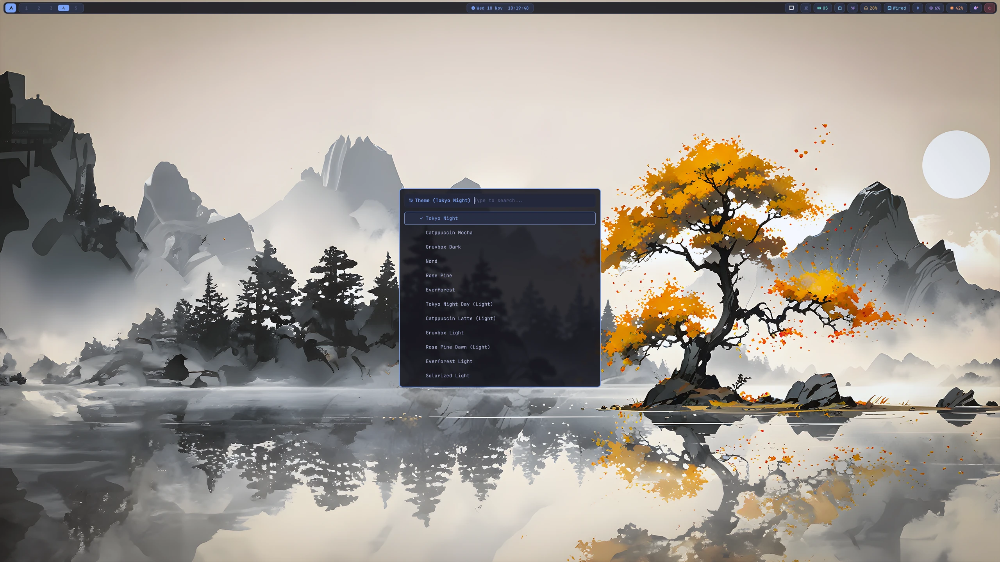
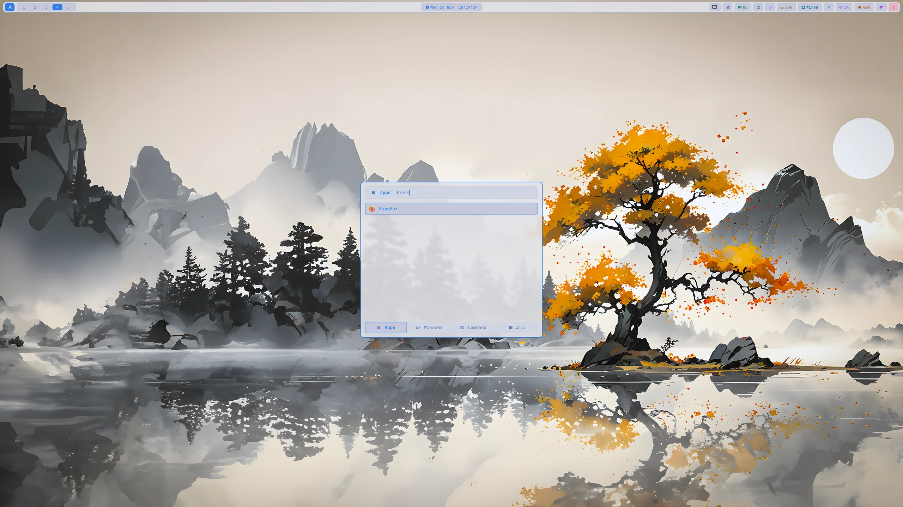
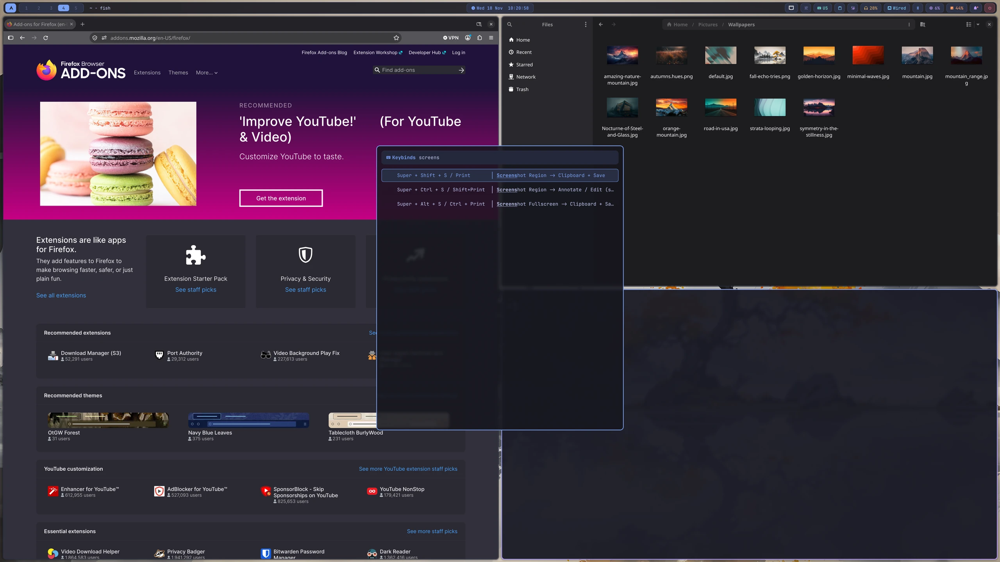
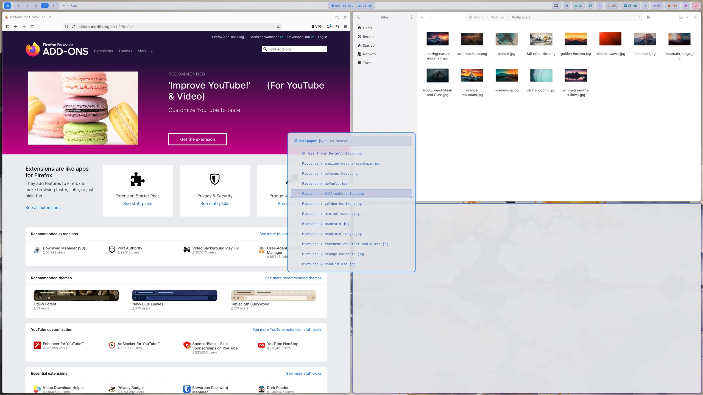

# vince-hyper

A minimal, fast, productivity-focused **Hyprland (`0.55+` / `0.57+` native Lua)** desktop configuration for **CachyOS / Arch Linux**.

A clean aesthetic with a high-contrast floating pill-based Waybar, a multi-tab Rofi launcher (**Apps**, **Windows**, **Command**, **Calc**), and a curated 12-theme switcher (6 Dark + 6 Light), paired with **Sway / i3 / Vim (`H/J/K/L`) dwindle + tabbed-group window management** and standard Wayland components (**Waybar**, **Rofi**, **SwayNC**, **SwayOSD**, **Hyprlock**, **Kitty**, **Cliphist**, **Grim/Slurp/Satty**).

---

## Screenshots

| Dark Mode (Tokyo Night) | Light Mode (Tokyo Night Day) |
| :---: | :---: |
| [](assets/dark-launcher.webp)<br><sub>**12-Palette Theme Switcher** (`Super + Shift + T`)</sub> | [](assets/light-launcher.webp)<br><sub>**Multi-Tab Rofi Launcher** (`Apps` · `Windows` · `Command` · `Calc`)</sub> |
| [](assets/dark-workspace.webp)<br><sub>**Dwindle Tiling + Searchable Keybind Cheat Sheet** (`Super + /`)</sub> | [](assets/light-workspace.webp)<br><sub>**Light GTK / Papirus Sync + Wallpaper Switcher** (`Super + Ctrl + W`)</sub> |

---

## Philosophy & Design Goals

1. **Zero Bloat / No Gimmicks**: No custom Quickshell/AGS/Astal daemons, no audio visualizer bars, no docks, no anime wallpapers. Just a crisp floating pill top panel and fast keyboard-driven workflows.
2. **Standardized Sway / i3 / Vim Ergonomics**: `Super + H/J/K/L` focuses windows (`Left/Down/Up/Right`, stopping cleanly at screen edges), `Super + Shift + H/J/K/L` moves windows, `Super + Ctrl + H/J/K/L` resizes windows, and `Super + W` manages tabbed window groups (`Super + Alt + H/L` to switch tabs, `Super + Shift + W` to pop out).
3. **Multi-Tab Rofi Launcher**: Launching Rofi (`Super`, `Super + D`, `Super + Tab`, or `Super + =`) displays a unified bottom mode-switcher bar (`Apps`, `Windows`, `Command`, `Calc`) switchable via mouse click or `Ctrl + Tab` / `Shift + Left/Right`, while single-purpose `-dmenu` menus stay compact and tab-free.
4. **Unified 12-Palette Theme Switcher**: One script (`theme-switcher`) simultaneously updates **Hyprland borders & tabbed groupbars**, **Hyprlock** (with live desktop screenshot blur), **Waybar floating pills & interactive Pango calendar pop-over**, **Rofi**, **Kitty**, **SwayNC** (including `:root` variables for crisp light-theme action buttons), **SwayOSD**, **GTK 3/4 (`Adwaita-dark` / `Adwaita`)**, **Qt6 (`qt6ct`)**, **Papirus icons (`Papirus-Dark` / `Papirus-Light`)**, and **Hyprpaper** wallpapers across 12 palettes (6 dark + 6 light):
   - **Dark**: **Tokyo Night** *(default)*, **Catppuccin Mocha**, **Gruvbox Dark**, **Nord**, **Rosé Pine**, **Everforest**
   - **Light**: **Tokyo Night Day (Light)**, **Catppuccin Latte (Light)**, **Gruvbox Light**, **Rose Pine Dawn (Light)**, **Everforest Light**, **Solarized Light**
5. **Rounded Window Aesthetics + Native Maximized-Window Indicator**: Every tiled window—even when solo on a workspace—retains crisp rounded corners, breathing gaps, subtle drop shadows, and dual-pass frosted blur, while Waybar's built-in `hyprland/windowcount` pill (`󰊓 N`) appears whenever a window is maximized (`Super + M`)—highlighted in `@orange` when other tiled windows are hidden underneath—with left-click to unmaximize and right-click to switch hidden windows.
6. **Fractional Scaling (`1.25x`) & Compositor Efficiency**: Tuned fontconfig (`hintnone`, grayscale AA, no stem darkening) and `Xft.dpi: 120` for razor-sharp rendering at `1.25x` scale, VFR + direct scanout for minimal GPU usage, automatic idle inhibition during fullscreen apps and tiled browser video calls, and multi-device synchronized `US` <-> `IT` keyboard layout switching with SwayOSD feedback.

---

## Repository Structure

```text
vince-hyper/
├── apply.sh                     # Bootstrap & sync script (apply / upgrade, --sync-back)
├── README.md                    # User & AI Agent architecture documentation
├── assets/                      # Optimized desktop preview screenshots
├── bin/                         # Installed to ~/.local/bin/
│   ├── theme-switcher           # Rofi theme selector + multi-app / GTK / Papirus palette generator
│   ├── wallpaper-switcher       # Rofi wallpaper selector (Pictures/Wallpapers + System)
│   ├── switch-layout            # Synchronized multi-device keyboard layout switcher (US <-> IT) + SwayOSD
│   ├── rofi-calc                # Inline Rofi calculator mode (qalc + Python math fallback + wl-copy)
│   ├── screenshot               # grim + slurp + satty + wl-copy screenshot utility
│   ├── clipboard-menu           # cliphist + rofi clipboard manager
│   ├── power-menu               # rofi power menu (lock, suspend, logout, reboot, shutdown)
│   └── keybinds-menu            # Searchable rofi keybinding cheat sheet
└── config/                      # Installed to ~/.config/
    ├── hypr/
    │   ├── hyprland.lua         # Main Hyprland 0.57+ native Lua configuration
    │   ├── theme.lua            # Auto-generated border/groupbar colors from theme-switcher
    │   ├── hyprpaper.conf       # Auto-generated wallpaper config from theme-switcher
    │   ├── hyprlock.conf        # Theme-aware lockscreen configuration (sources hyprlock-colors.conf)
    │   ├── hyprlock-colors.conf # Auto-generated lockscreen palette from theme-switcher
    │   └── hypridle.conf        # Idle daemon (10m lock, 15m DPMS off)
    ├── waybar/
    │   ├── config.jsonc         # Floating pill top panel, windowcount badge & interactive calendar
    │   ├── style.css            # High-contrast pill styling with per-module semantic colors
    │   └── colors.css           # Auto-generated palette variables (including @bg_bar, @bg_pill, @dark_text)
    ├── rofi/
    │   ├── config.rasi          # Rofi modes (drun, window, run, calc), bottom tab bar & Papirus icons
    │   ├── theme.rasi           # Launcher & bottom mode-switcher styling (imports colors.rasi)
    │   └── colors.rasi          # Auto-generated palette variables
    ├── kitty/
    │   ├── kitty.conf           # Terminal font, padding, tab bar (includes colors.conf)
    │   └── colors.conf          # Auto-generated 16-color terminal palette
    ├── swaync/
    │   ├── config.json          # Notification daemon & control center config
    │   ├── style.css            # High-contrast notification & button styling (imports colors.css)
    │   └── colors.css           # Auto-generated :root & @define-color palette variables
    ├── swayosd/
    │   ├── style.css            # Theme-aware OSD pill styling (imports colors.css)
    │   └── colors.css           # Auto-generated OSD palette variables
    ├── fontconfig/
    │   └── fonts.conf           # Fontconfig tuned for 1.25x fractional scaling (hintnone, grayscale AA)
    ├── themes/
    │   └── current              # Stores active theme name
    ├── uwsm/
    │   └── env                  # Wayland environment variables
    └── mimeapps.list            # Default file manager (Nautilus) & browser associations
```

---

## Quick Start / Installation

### 1. Install or Update (Fresh or Existing System)
```bash
git clone git@github.com:vincepii/vince-hyper.git ~/src/vincepii/vince-hyper
cd ~/src/vincepii/vince-hyper
./apply.sh
```
`./apply.sh` automatically:
1. Checks if any required packages are missing and installs only the missing ones via `pacman`.
2. Configures `/etc/xdg/swayosd/backend.toml` (`ignore_caps_lock_key = true`, preserving other sections) and restarts `swayosd-libinput-backend.service` if active.
3. Backs up your existing `~/.config` directories to `~/.cache/vince-hyper-backup-<timestamp>`.
4. Deploys all configurations and scripts, generates the gradient wallpapers, and **preserves your currently active theme** (defaulting to **Tokyo Night** only on a brand-new installation).

*(Note: Google Chrome is launched via `flatpak run com.google.Chrome` by default. If you use native Chrome or another browser, update `local browser` in `config/hypr/hyprland.lua`. For machine-specific multi-monitor layouts or scaling, create an untracked `~/.config/hypr/monitors.lua`—`hyprland.lua` loads it automatically via `pcall(require, "monitors")` without touching `git status`.)*

### 2. Saving Local Tweaks Back to the Repo
If you edit files directly in `~/.config/` or `~/.local/bin/` and want to commit them back to this repository:
```bash
./apply.sh --sync-back
git diff
```

---

## Keybindings Reference

| Shortcut | Action |
| :--- | :--- |
| **`Super` (tap Left or Right)** | App Launcher (`rofi -show drun`, with bottom `Apps` / `Windows` / `Command` / `Calc` tabs) |
| **`Super + D`** / **`Super + Space`** | App Launcher (`rofi -show drun`) |
| **`Super + Tab`** / **`Alt + Tab`** | Window Switcher (`rofi -show window`) / Cycle next window |
| **`Super + =`** | Inline Calculator (`rofi -show calc`, auto-copies result to clipboard) |
| **`Super + .`** | Emoji Picker (`rofimoji` -> types into active window + copies to clipboard) |
| **`Super + V`** | Clipboard History (`cliphist` + Rofi -> copies selection to clipboard) |
| **`Super + Return`** | Terminal (`kitty`) |
| **`Super + B`** | Browser (`Google Chrome`) |
| **`Super + E`** | File Manager (`nautilus`) |
| **`Ctrl + Shift + Escape`** | Toggle Centered Floating System Monitor (`btop`) |
| **`Super + Q`** / **`Super + Shift + Q`** / **`Super + C`** | Close Active Window |
| **`Super + F`** / **`Super + M`** | Fullscreen (inhibits idle) / Maximize (keep Waybar + `󰊓` count badge) |
| **`Super + Shift + Space`** | Toggle Floating / Tiling Window |
| **`Super + P`** | Toggle Pseudo-Tile (Dwindle) |
| **`Super + O`** *(or `Super + \`)* | Toggle Split Orientation (Dwindle Horizontal/Vertical) |
| **`Super + W`** | Toggle Tabbed Window Group (`togglegroup`) |
| **`Super + Shift + W`** | Move Active Window Out of Tabbed Group (`moveoutofgroup`) |
| **`Super + Alt + H / L`** *(or `Alt + Left / Right`)* | Previous / Next Window Tab in Group |
| **`Super + H / J / K / L`** *(or Arrows)* | Focus Left / Down / Up / Right (stops at screen edge) |
| **`Super + Shift + H / J / K / L`** *(or Arrows)* | Move Window Left / Down / Up / Right |
| **`Super + Ctrl + H / J / K / L`** *(or Arrows)* | Resize Window Left / Down / Up / Right (`40px` steps) |
| **`Super + 1..0`** | Switch to Workspace 1–10 |
| **`Super + Shift + 1..0`** | Move Active Window to Workspace 1–10 (and follow) |
| **`Super + Ctrl + 1..0`** | Move Active Window Silently to Workspace 1–10 |
| **`Super + [`** / **`Super + ]`** *(or `Super + Scroll`)* | Cycle Previous / Next Workspace (`e-1` / `e+1`) |
| **`Super + -`** / **`Super + S`** | Toggle Scratchpad Special Workspace |
| **`Super + Shift + -`** | Move Active Window to Scratchpad |
| **`Super + Shift + S`** *(or `Print`)* | Screenshot Region -> Clipboard + `~/Pictures/Screenshots/` |
| **`Super + Ctrl + S`** *(or `Shift + Print` / `Super + Print`)* | Screenshot Region -> Annotate/Edit (`satty`) -> Clipboard + Save |
| **`Super + Alt + S`** *(or `Ctrl + Print`)* | Screenshot Fullscreen -> Clipboard + Save |
| **`Super + Shift + C`** | Color Picker (`hyprpicker` -> Hex to Clipboard) |
| **`Super + Shift + T`** | Theme Selector (`theme-switcher`, 12 Dark & Light themes) |
| **`Super + Ctrl + W`** | Wallpaper Selector (`wallpaper-switcher` / Right-click `󰔎` in bar) |
| **`Super + N`** | Toggle Notification Center (`swaync`) |
| **`Ctrl + Alt + L`** / **`Super + Escape`** | Lock Screen Immediately (`hyprlock`) |
| **`Super + Shift + E`** | Power / Logout Menu (Lock, Suspend, Logout, Reboot, Shutdown) |
| **`Super + Shift + B`** / **`Super + Shift + R`** | Restart Waybar / Reload Hyprland + Waybar |
| **`Super + /`** *(or `Super + ?`)* | Open Searchable Keybind Cheat Sheet |
| **`CapsLock`** / **`Super + Ctrl + Space`** | Switch Keyboard Layout (`US` <-> `IT`) across all devices + SwayOSD |

---

## Guide for Future AI Agents

When assisting the user with modifications to this desktop setup, follow these architectural rules:

1. **Hyprland `0.55+` / `0.57+` Uses Native Lua (`hyprland.lua`)**:
   - CachyOS's Hyprland package (`0.57+`) evaluates `~/.config/hypr/hyprland.lua` using the `hl.*` Lua API (type stubs are located at `/usr/share/hypr/stubs/hl.meta.lua`).
   - Do **not** create legacy `hyprland.conf` files unless specifically requested; edit `config/hypr/hyprland.lua`.
   - Note that external CLI calls via `hyprctl dispatch ...` (e.g., in Waybar `on-click` / `on-scroll-*` handlers) must still use standard CLI dispatcher syntax (`hyprctl dispatch workspace e+1`, `hyprctl dispatch fullscreen 1`), **not** `hl.dsp.*` Lua syntax.
   - Validate `hyprland.lua` at any time using `Hyprland --verify-config -c config/hypr/hyprland.lua`.
2. **Theme System Architecture (`bin/theme-switcher`)**:
   - Never hardcode hex colors inside `config/waybar/style.css`, `config/rofi/theme.rasi`, `config/kitty/kitty.conf`, `config/swaync/style.css`, or `config/hypr/hyprlock.conf`.
   - `bin/theme-switcher` generates:
     - `~/.config/hypr/theme.lua` (borders + `group` / `groupbar` colors)
     - `~/.config/hypr/hyprlock-colors.conf` (sourced by `hyprlock.conf`)
     - `~/.config/waybar/colors.css` + Pango hex colors in `~/.config/waybar/config.jsonc` (`clock` calendar & `custom/notification` dot)
     - `~/.config/rofi/colors.rasi` + `icon-theme` in `config.rasi`
     - `~/.config/kitty/colors.conf`
     - `~/.config/swaync/colors.css` (`:root` variables + `@define-color` fallbacks)
     - `~/.config/gtk-3.0/settings.ini`, `~/.config/gtk-4.0/settings.ini`, and `gsettings`.
3. **Keyboard Layout Switching (`bin/switch-layout`)**:
   - Keep `kb_options = "caps:none"` and route `code:66` (`CapsLock`), `Super + Ctrl + Space`, and Waybar's language pill through `~/.local/bin/switch-layout` so multi-interface keyboards never desync.
4. **Syncing & Privacy**:
   - Keep `~/src/vincepii/vince-hyper` and live `~/.config` / `~/.local/bin` in sync via `./apply.sh` or `./apply.sh --sync-back`.
   - Never commit hardcoded usernames, hostnames, MAC addresses, Wi-Fi SSIDs, or secrets.
